<!-- Versión en español de https://github.com/sonyrp · el arte comparte los textos en inglés del original -->
<p align="center">
  
</p>

<p align="center">
  <a href="https://github.com/sonyrp">
    
  </a>
</p>

<p align="center">
  <a href="https://github.com/sonyrp">🇬🇧 English</a> &nbsp;·&nbsp; <b>🇨🇴 Español</b>
</p>

<p align="center">
  <a href="https://www.linkedin.com/in/sonia-restrepo-perez">
    
  </a>
  
  
</p>

<p align="center"><picture><source media="(prefers-color-scheme: dark)" srcset="assets/divider-hat-dark.svg"/>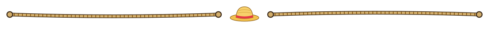</picture></p>

## 🏴‍☠️ Bitácora de la capitana

<table>
  <tr>
    <td width="36%" align="center" valign="top">
      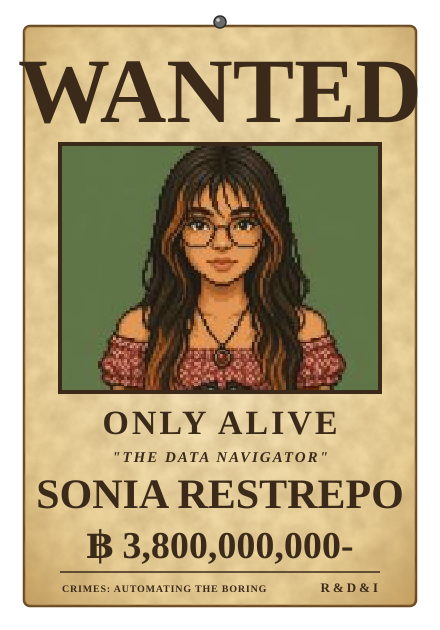
      <br><sub>Recompensa en vivo: ฿1.000.000.000 + ฿10.000.000 por cada contribución del último año, actualizada a diario</sub>
    </td>
    <td valign="top">

Soy **Ingeniera Física** de la Universidad Tecnológica de Pereira: aprendí a leer el universo con ecuaciones, y ahora uso eso para enseñarles a las máquinas a pensar.

Navego como **Ingeniera de Datos e IA en el área de I+D+i de Integra S.A.**, construyendo software, trazando arquitecturas de datos y subiendo la inteligencia artificial a bordo de la operación de la empresa. Mi sueño: que las máquinas hagan el trabajo repetitivo para que las personas hagan el creativo.

📍 Pereira, Colombia · 🎓 Maestría en Ingeniería de Sistemas y Computación (UTP)

```python
class Captain:
    name      = "Sonia Restrepo"
    epithet   = "The Data Navigator"
    ship      = "R&D&I @ Integra S.A."
    home_sea  = "Pereira, Colombia 🇨🇴"
    origin    = ["Physics Engineering ⚛️",
                 "M.Sc. Systems & Computer Engineering"]
    haki      = ["Artificial Intelligence", "Data Engineering",
                 "Process Automation", "Optimization"]
    dream     = "Bring AI from the lab into everyday business"

    def set_sail(self):
        return "Vibecoding at full sail ⛵"
```

</td>
  </tr>
</table>

<p align="center"><picture><source media="(prefers-color-scheme: dark)" srcset="assets/divider-logpose-dark.svg"/>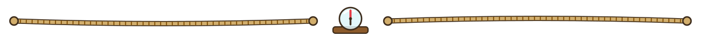</picture></p>

## 🗺️ El mapa de mi travesía

<p align="center">
  
</p>

<p align="center">
  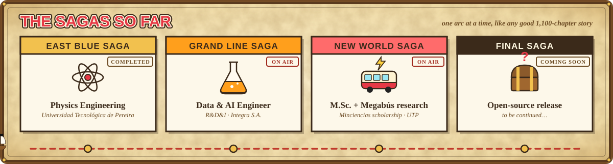
</p>

<p align="center"><picture><source media="(prefers-color-scheme: dark)" srcset="assets/divider-skull-dark.svg"/>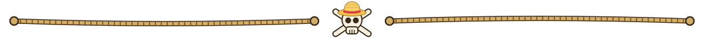</picture></p>

## 🍇 Poderes de Fruta del Diablo

<p align="center">
  
</p>

<p align="center"><sub>Debilidad conocida: el mar de código heredado sin documentar 🌊</sub></p>

<p align="center"><picture><source media="(prefers-color-scheme: dark)" srcset="assets/divider-meat-dark.svg"/>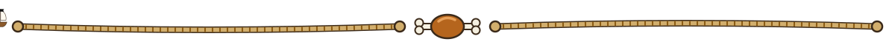</picture></p>

## ⚡ Arco actual: la Isla Megabús

<p align="center">
  
</p>

> **Sistema inteligente de optimización de carga de baterías para la flota eléctrica del SITM Megabús**
> *Investigación de maestría financiada por Minciencias (Becas para el Cambio) · I+D+i Integra S.A. × UTP*

Cargar un bus eléctrico suena simple, pero hacerlo al menor costo, cuidando la batería y sin sobrecargar la red es un problema de optimización nivel Nuevo Mundo. Lo estoy resolviendo con IA:

- 🧬 **Algoritmos evolutivos** (genético + PSO, NSGA-II) para equilibrar costo de energía y desgaste de batería
- 🧠 **Machine learning** sobre telemetría real de la flota para predecir el estado de carga de cada bus y la demanda de las próximas 24 h
- 🧭 **Arquitectura de doble horizonte**: planeación a 24 h + ajuste en tiempo real con datos IoT (un Eternal Pose y un Log Pose)
- 💰 El tesoro: se liberará como **código abierto (MIT)** para que otros sistemas de transporte del país puedan adoptarlo

<p align="center"><picture><source media="(prefers-color-scheme: dark)" srcset="assets/divider-helm-dark.svg"/>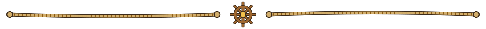</picture></p>

## ⚓ La tripulación

<p align="center">
  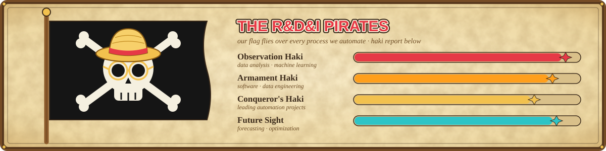
</p>

<p align="center">
  
</p>

<p align="center"><picture><source media="(prefers-color-scheme: dark)" srcset="assets/divider-swords-dark.svg"/>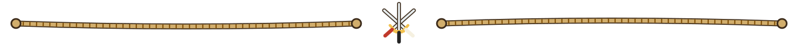</picture></p>

## 💰 Tesoros encontrados hasta ahora

<p align="center">
  <a href="https://github.com/sonyrp/phishing-detector">
    
  </a>
</p>

<p align="center"><picture><source media="(prefers-color-scheme: dark)" srcset="assets/divider-chest-dark.svg"/>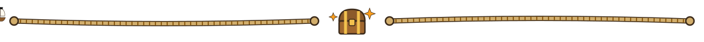</picture></p>

## 📰 Entrega del News Coo

<p align="center">
  
</p>

<p align="center"><picture><source media="(prefers-color-scheme: dark)" srcset="assets/divider-logpose-dark.svg"/></picture></p>

## 📜 Cuaderno de bitácora

<p align="center">
  
</p>

<p align="center"><picture><source media="(prefers-color-scheme: dark)" srcset="assets/divider-anchor-dark.svg"/>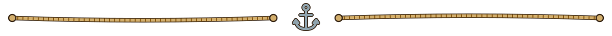</picture></p>

## 🍖 La vida en cubierta

<table align="center">
  <tr>
    <td align="center">🚀<br><b>Ciencia ficción</b><br><sub>Futuros posibles e imposibles</sub></td>
    <td align="center">🏴‍☠️<br><b>Anime</b><br><sub>Más de 1.100 episodios y sigo navegando</sub></td>
    <td align="center">📖<br><b>Manga</b><br><sub>Siempre hay un capítulo más</sub></td>
    <td align="center">📚<br><b>Literatura</b><br><sub>El mayor poneglyph de la humanidad</sub></td>
  </tr>
</table>

<p align="center">
  
</p>

<p align="center"><picture><source media="(prefers-color-scheme: dark)" srcset="assets/divider-meat-dark.svg"/></picture></p>

## ⛵ La bitácora del Grand Line

<p align="center">
  
</p>

<p align="center"><picture><source media="(prefers-color-scheme: dark)" srcset="assets/divider-hat-dark.svg"/></picture></p>

## 🐌 Den Den Mushi

<p align="center">
  <a href="https://www.linkedin.com/in/sonia-restrepo-perez">
    
  </a>
</p>

<!-- ═══════════════════  FOOTER  ═══════════════════ -->
<p align="center">
  
</p>
