<!-- ═══════════════════  HEADER  ═══════════════════ -->
<p align="center">
  
</p>

<p align="center">
  <a href="https://github.com/sonyrp">
    
  </a>
</p>

<p align="center">
  <b>🇬🇧 English</b> &nbsp;·&nbsp; <a href="README.es.md">🇨🇴 Español</a>
</p>

<p align="center">
  <a href="https://www.linkedin.com/in/sonia-restrepo-perez">
    
  </a>
  
  
</p>

<p align="center"><picture><source media="(prefers-color-scheme: dark)" srcset="assets/divider-hat-dark.svg"/></picture></p>

## 🏴‍☠️ Captain's log

<table>
  <tr>
    <td width="36%" align="center" valign="top">
      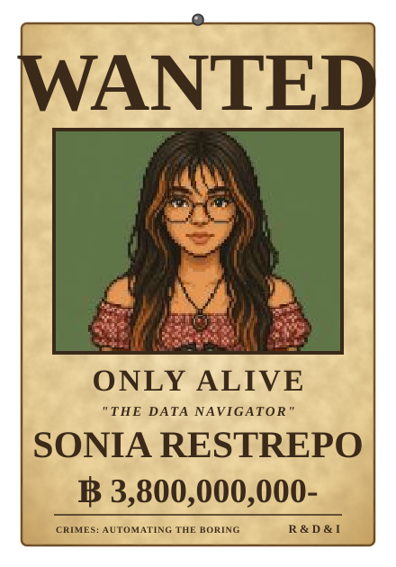
      <br><sub>Live bounty: ฿1,000,000,000 + ฿10,000,000 per contribution in the last year, updated daily</sub>
    </td>
    <td valign="top">

I'm a **Physics Engineer** from Universidad Tecnológica de Pereira: I learned to read the universe through equations, and now I use that to teach machines how to think.

I sail as a **Data & AI Engineer in the R&D&I department at Integra S.A.**, building software, charting data architectures and bringing artificial intelligence aboard the company's operations. My dream: let machines do the repetitive work so people can do the creative work.

📍 Pereira, Colombia · 🎓 M.Sc. in Systems and Computer Engineering (UTP)

```python
class Captain:
    name      = "Sonia Restrepo"
    epithet   = "The Data Navigator"
    ship      = "R&D&I @ Integra S.A."
    home_sea  = "Pereira, Colombia 🇨🇴"
    origin    = ["Physics Engineering ⚛️",
                 "M.Sc. Systems & Computer Engineering"]
    haki      = ["Artificial Intelligence", "Data Engineering",
                 "Process Automation", "Optimization"]
    dream     = "Bring AI from the lab into everyday business"

    def set_sail(self):
        return "Vibecoding at full sail ⛵"
```

</td>
  </tr>
</table>

<p align="center"><picture><source media="(prefers-color-scheme: dark)" srcset="assets/divider-logpose-dark.svg"/>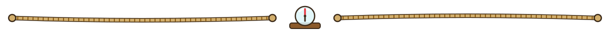</picture></p>

## 🗺️ The map of my voyage

<p align="center">
  
</p>

<p align="center">
  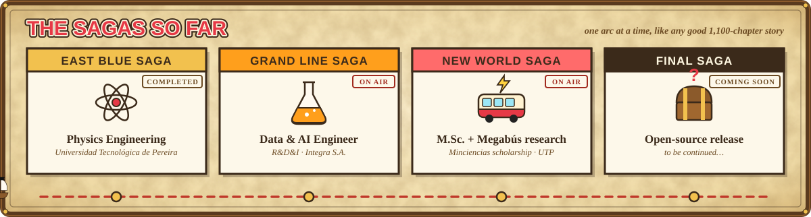
</p>

<p align="center"><picture><source media="(prefers-color-scheme: dark)" srcset="assets/divider-skull-dark.svg"/></picture></p>

## 🍇 Devil Fruit powers

<p align="center">
  
</p>

<p align="center"><sub>Known weakness: the sea of undocumented legacy code 🌊</sub></p>

<p align="center"><picture><source media="(prefers-color-scheme: dark)" srcset="assets/divider-meat-dark.svg"/>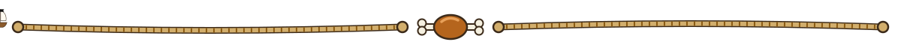</picture></p>

## ⚡ Current arc: Megabús Island

<p align="center">
  
</p>

> **Intelligent battery-charging optimization system for the SITM Megabús electric fleet**
> *Master's research funded by Colombia's Ministry of Science, Minciencias (Becas para el Cambio) · R&D&I Integra S.A. × UTP*

Charging an electric bus sounds simple, but doing it at the lowest cost, protecting the battery and without overloading the grid is a New World-level optimization problem. I'm solving it with AI:

- 🧬 **Evolutionary algorithms** (genetic + PSO, NSGA-II) to balance energy cost and battery wear
- 🧠 **Machine learning** on real fleet telemetry to predict each bus's state of charge and the next 24 h of demand
- 🧭 **Dual-horizon architecture**: 24 h planning + real-time adjustment with IoT data (an Eternal Pose and a Log Pose)
- 💰 The treasure: it will be released as **open source (MIT)** so other transit systems in the country can adopt it

<p align="center"><picture><source media="(prefers-color-scheme: dark)" srcset="assets/divider-helm-dark.svg"/></picture></p>

## ⚓ The crew

<p align="center">
  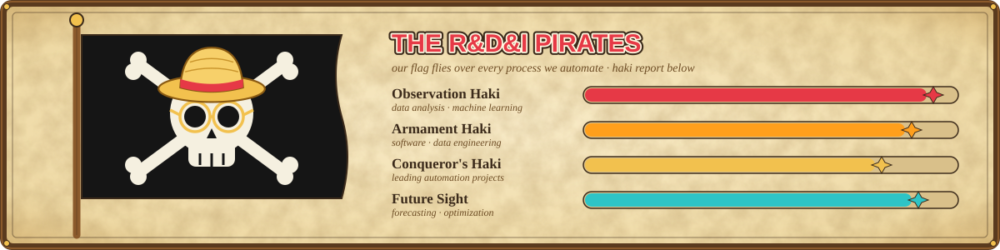
</p>

<p align="center">
  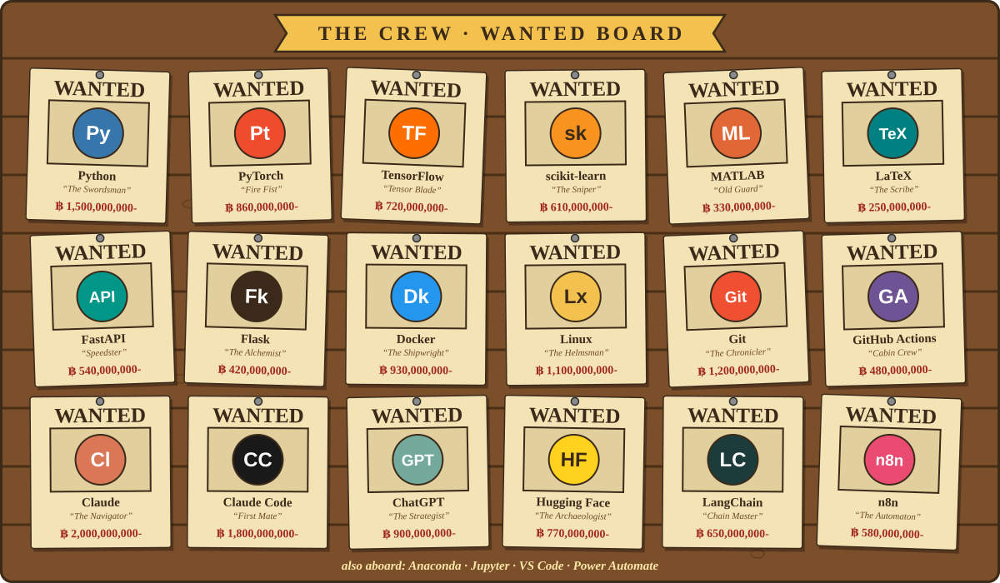
</p>

<p align="center"><picture><source media="(prefers-color-scheme: dark)" srcset="assets/divider-swords-dark.svg"/>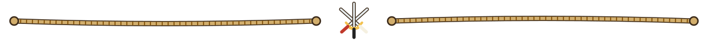</picture></p>

## 💰 Treasures found so far

<p align="center">
  <a href="https://github.com/sonyrp/phishing-detector">
    
  </a>
</p>

<p align="center"><picture><source media="(prefers-color-scheme: dark)" srcset="assets/divider-chest-dark.svg"/></picture></p>

## 📰 News Coo delivery

<p align="center">
  
</p>

<p align="center"><picture><source media="(prefers-color-scheme: dark)" srcset="assets/divider-logpose-dark.svg"/></picture></p>

## 📜 Ship's logbook

<p align="center">
  
</p>

<p align="center"><picture><source media="(prefers-color-scheme: dark)" srcset="assets/divider-anchor-dark.svg"/></picture></p>

## 🍖 Life on deck

<table align="center">
  <tr>
    <td align="center">🚀<br><b>Sci-fi</b><br><sub>Possible and impossible futures</sub></td>
    <td align="center">🏴‍☠️<br><b>Anime</b><br><sub>1,100+ episodes and still sailing</sub></td>
    <td align="center">📖<br><b>Manga</b><br><sub>There's always one more chapter</sub></td>
    <td align="center">📚<br><b>Literature</b><br><sub>Humanity's greatest poneglyph</sub></td>
  </tr>
</table>

<p align="center">
  
</p>

<p align="center"><picture><source media="(prefers-color-scheme: dark)" srcset="assets/divider-meat-dark.svg"/></picture></p>

## ⛵ The Grand Line logbook

<p align="center">
  
</p>

<p align="center"><picture><source media="(prefers-color-scheme: dark)" srcset="assets/divider-hat-dark.svg"/></picture></p>

## 🐌 Den Den Mushi

<p align="center">
  <a href="https://www.linkedin.com/in/sonia-restrepo-perez">
    
  </a>
</p>

<!-- ═══════════════════  FOOTER  ═══════════════════ -->
<p align="center">
  
</p>
