<!-- ═══════════════════  ENCABEZADO  ═══════════════════ -->
<p align="center">
  
</p>

<p align="center">
  <a href="https://github.com/sonyrp">
    
  </a>
</p>

<p align="center">
  <a href="https://www.linkedin.com/in/sonia-marcela-restrepo-perez-83b893289">
    
  </a>
  
  
</p>

---

## 🛸 `>> transmisión entrante desde el laboratorio`

Soy **ingeniera física** de la Universidad Tecnológica de Pereira: aprendí a entender el universo con ecuaciones y hoy lo aplico a enseñarles a las máquinas a pensar.
Trabajo como **Data & AI Engineer en el área de I+D+i de Integra S.A.**, construyendo software, estructurando arquitecturas de datos e integrando inteligencia artificial para potenciar la operación. Mi misión: que las máquinas hagan el trabajo repetitivo para que las personas hagan el creativo.

📍 Pereira, Colombia · 🎓 Maestría en Ingeniería de Sistemas y Computación (UTP)

```python
class Sonia:
    def __init__(self):
        self.rol         = "Data & AI Engineer"
        self.formacion   = ["Ingeniería Física ⚛️", "Maestría en Ing. de Sistemas y Computación"]
        self.trabajo     = "I+D+i @ Integra S.A."
        self.base        = "Pereira, Colombia 🇨🇴"
        self.enfoque     = ["Inteligencia Artificial", "Ingeniería de datos",
                            "Automatización de procesos", "Optimización",
                            "Vibecoding", "Prototipado rápido"]
        self.superpoder  = "Convertir procesos manuales en flujos automáticos"
        self.combustible = ["ciencia ficción 🚀", "anime 🌸", "manga 📖", "literatura 📚"]

    def mision(self):
        return "Llevar la IA del laboratorio al día a día de la empresa"

print(Sonia().mision())
```

---

## 🧪 Lo que hago en el laboratorio

| 🤖 **IA aplicada** | 🗄️ **Datos** | ⚙️ **Automatización** | ✨ **Vibecoding** |
|:---:|:---:|:---:|:---:|
| Integro IA en procesos reales de la empresa | Diseño arquitecturas y pipelines de datos | Elimino tareas manuales y repetitivas | Prototipos a la velocidad de una idea, programando junto a la IA |

---

## 🔋 Misión en curso: buses eléctricos inteligentes

> **Sistema inteligente de optimización de la gestión de carga de baterías para la flota eléctrica del SITM Megabús**
> *Proyecto de maestría financiado por Minciencias (Becas para el Cambio) · I+D+i Integra S.A. × UTP*

Cargar un bus eléctrico parece simple, pero hacerlo al menor costo, cuidando la batería y sin sobrecargar la red es un enorme problema de optimización. Lo estoy resolviendo con IA:

- 🧬 **Algoritmos evolutivos** (genético + PSO, NSGA-II) para equilibrar costo de energía y desgaste de baterías
- 🧠 **Machine learning** con telemetría real de la flota para predecir el estado de carga y la demanda de las próximas 24 h
- ⏱️ **Arquitectura de doble horizonte**: planificación a 24 h + ajuste en tiempo real con datos IoT
- 🌎 Se liberará como **código abierto (MIT)** para que otros sistemas de transporte del país puedan usarlo

---

## 🧰 Arsenal tecnológico

<p align="center"><b>Lenguajes y ciencia de datos</b></p>
<p align="center">
  
</p>

<p align="center"><b>Desarrollo y herramientas</b></p>
<p align="center">
  
</p>

<p align="center"><b>IA y automatización</b></p>
<p align="center">
  
  
  
  
  
  
  
  
</p>

---

## 🚀 Proyectos en órbita

<p align="center">
  <a href="https://github.com/sonyrp/phishing-detector">
    
  </a>
  
  
</p>

> 🎣 **phishing-detector** — Detecta correos y mensajes de phishing con NLP y Machine Learning.
> 🛰️ *Más proyectos de IA y automatización aterrizando pronto...*

---

## 📡 Telemetría de la nave

<p align="center">
  
</p>

---

## 📚 Fuera del laboratorio

<table align="center">
  <tr>
    <td align="center">🚀<br><b>Ciencia ficción</b><br><sub>Futuros posibles e imposibles</sub></td>
    <td align="center">🌸<br><b>Anime</b><br><sub>Historias que se quedan</sub></td>
    <td align="center">📖<br><b>Manga</b><br><sub>Siempre hay otro tomo</sub></td>
    <td align="center">📚<br><b>Literatura</b><br><sub>El mejor dataset de la humanidad</sub></td>
  </tr>
</table>

<p align="center"><i>"Cualquier tecnología suficientemente avanzada es indistinguible de la magia." — Arthur C. Clarke</i></p>

---

## 🐍 La serpiente que devora mis contribuciones

<p align="center">
  <picture>
    <source media="(prefers-color-scheme: dark)" srcset="https://raw.githubusercontent.com/sonyrp/sonyrp/output/github-snake-dark.svg"/>
    
  </picture>
</p>

<!-- ═══════════════════  PIE  ═══════════════════ -->
<p align="center">
  
</p>
